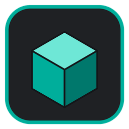
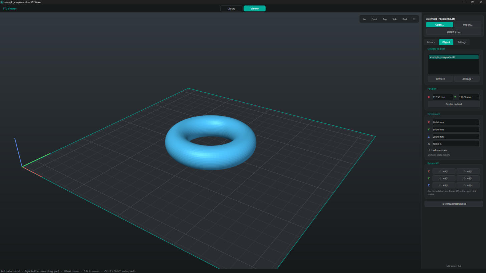
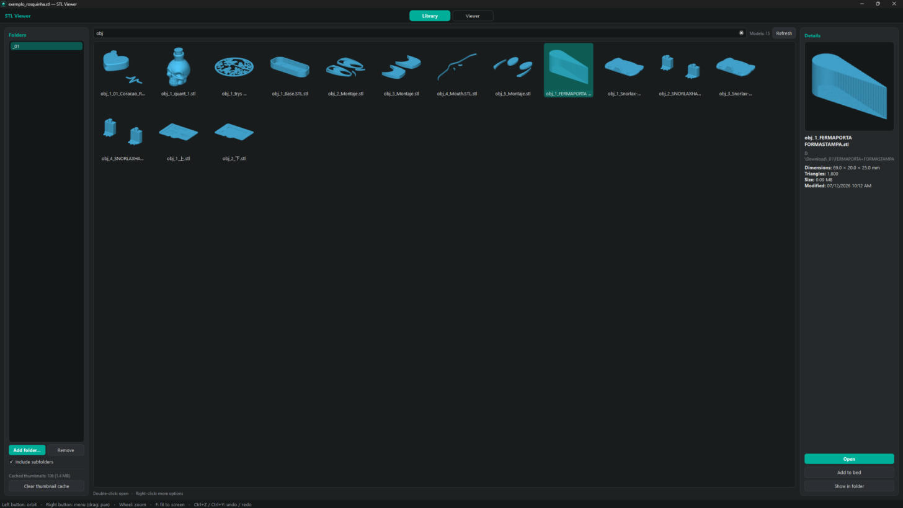
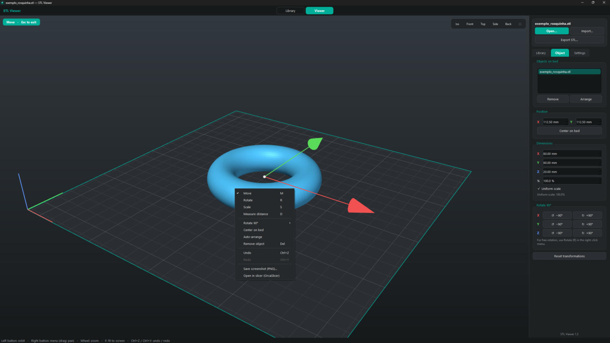

<div align="center">



# STL Viewer

**A 3D model viewer and organizer for Windows, made for 3D printing.**
Open, measure, position and resize your models, browse your folders with thumbnails and send everything ready to your slicer.

[](https://ko-fi.com/darkdragonal)


🇺🇸 **English** &nbsp;|&nbsp; 🇧🇷 [Português](README.pt-BR.md)

</div>



## Features

- **Formats:** STL (ASCII and binary), 3MF (including OrcaSlicer, Bambu Studio and PrusaSlicer projects), OBJ and PLY. **.zip** files from Printables and Thingiverse open directly, letting you pick the models inside.
- **On-model tools:** move, rotate (free or in 5° steps) and scale by dragging handles, just like in slicers.
- **Measure distance** between two points on the model, with ΔX, ΔY and ΔZ.
- **Multiple objects on the bed:** import more models, select with a click and use **Auto-arrange** to spread them out without touching.
- **Undo and redo** (Ctrl+Z / Ctrl+Y) for every change.
- **Configurable build volume:** objects turn red when they leave the print area.
- **Library** with thumbnails of your folders, search by name and a details panel (dimensions, triangles, size and date).
- **Open in slicer:** sends the objects, already positioned, to OrcaSlicer, PrusaSlicer, Bambu Studio, UltiMaker Cura, SuperSlicer, Creality Print or any other program.
- **Export STL** and **save screenshots (PNG)**.
- **7 languages:** Português (Brasil), English, Español, Français, Deutsch, Italiano and 日本語. The program starts in your Windows language and can be changed in **Settings → Language**.

<p align="center">
  
  
</p>

## How to use

| Action | How |
|---|---|
| Orbit the view | Drag with the left button |
| Pan the view | Drag with the right or middle button |
| Zoom | Mouse wheel |
| Tools menu | Right-click (without dragging) |
| Move / Rotate / Scale / Measure | **M** / **R** / **S** / **D** (Esc to exit) |
| Free rotation, without 5° steps | Hold **Shift** while dragging the ring |
| Fit to screen | **F** or double-click |
| Open / Import / Export | **Ctrl+O** / **Ctrl+I** / **Ctrl+E** |
| Undo / Redo | **Ctrl+Z** / **Ctrl+Y** |
| Remove object | **Delete** |

## Installation

### Option 1: download the ready-to-use program
1. On the [Releases](../../releases/latest) page, download **`VisualizadorSTL-…-windows.zip`**.
2. Extract it to a folder (for example, `Documents\STL Viewer`) and open **Visualizador STL.exe**.

> **“Windows protected your PC”?** This appears because the program is not signed with a paid certificate. Click **More info → Run anyway**. The code is open source and the `.exe` is built automatically by GitHub from it (see the *Actions* tab).

### Option 2: run from source
1. Install [Python 3.10 or newer](https://www.python.org/downloads/), checking **Add python.exe to PATH**.
2. Download this repository (**Code → Download ZIP**) and extract it.
3. Double-click **`Testar_sem_EXE.bat`** to open the program directly.
4. To build the `.exe`, double-click **`Gerar_EXE.bat`**. The program ends up in `dist\Visualizador STL`.

Or from a terminal:

```bat
pip install -r requirements.txt
python Visualizador_STL.py
```

### Open files with a double-click
In the program (`.exe` version), go to **Settings → Windows → Set as default viewer** and follow the instructions. It works for `.stl`, `.3mf`, `.obj` and `.ply`.

## FAQ

**Where are the settings and thumbnails stored?**
In `%APPDATA%\VisualizadorSTL`. If something goes wrong, the `erros.log` file in that folder helps find the cause. Thumbnails can be cleared in **Library → Clear thumbnail cache**.

**My slicer was not found.**
In **Settings → Slicer**, choose the program and click **Browse for executable…**.

**The model shows up in red.**
It is outside the build volume. Set your printer size in **Settings → Build volume** (default is 225 × 225 × 265 mm).

## Translations

All texts live in [`idiomas.py`](idiomas.py). Found an odd translation or want to add a language? Open an issue or send a pull request — just follow the pattern of the existing languages.

## Support the project

If STL Viewer helped you, consider buying me a coffee ☕

[](https://ko-fi.com/darkdragonal)

Suggestions and bug reports are welcome in [Issues](../../issues).

## License

Distributed under the MIT License. See [LICENSE](LICENSE).
