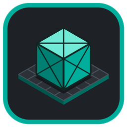
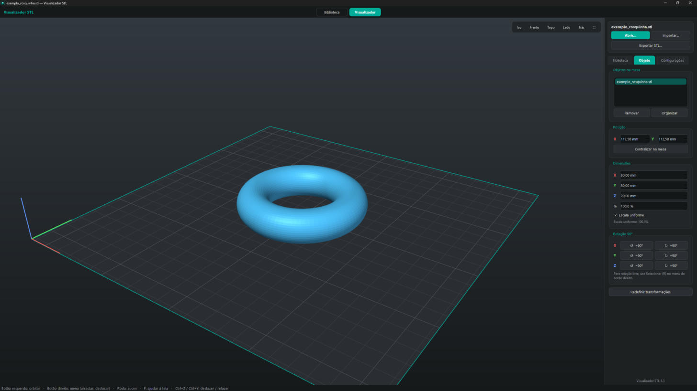
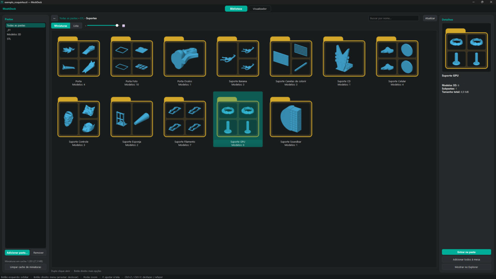
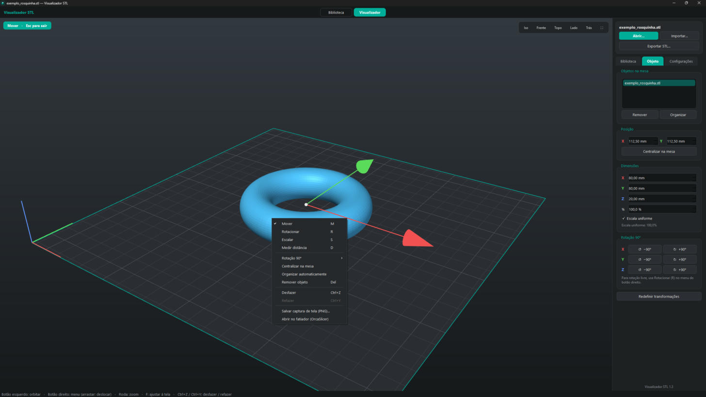

<div align="center">



# MeshDeck

**Visualizador e biblioteca de modelos 3D para Windows, feito para quem imprime em 3D.**
Abra, meça, posicione e redimensione seus modelos, e navegue pelas suas pastas com miniaturas.
Uma alternativa gratuita ao 3D Viewer do Windows, que foi descontinuado.

<sub>Antigo <i>Visualizador STL</i>.</sub>

[](https://ko-fi.com/darkdragonal)


🇺🇸 [English](README.md) &nbsp;|&nbsp; 🇧🇷 **Português**

</div>



## Recursos

- **Formatos:** STL (texto e binário), 3MF (inclusive projetos do OrcaSlicer, Bambu Studio e PrusaSlicer), OBJ e PLY. Arquivos **.zip** do Printables e do Thingiverse abrem direto, com a escolha dos modelos de dentro.
- **Ferramentas na própria peça:** mover, rotacionar (livre ou de 5 em 5°) e escalar arrastando os controles na própria peça.
- **Medir distância** entre dois pontos do modelo, com ΔX, ΔY e ΔZ.
- **Vários objetos na mesa:** importe mais modelos, selecione com um clique e use **Organizar automaticamente** para distribuí-los sem encostar.
- **Desfazer e refazer** (Ctrl+Z / Ctrl+Y) em todas as alterações.
- **Volume de impressão configurável:** o objeto fica vermelho quando sai da área da mesa.
- **Biblioteca** que funciona como o Explorer: entre nas pastas (botão ←, Backspace ou o botão voltar do mouse), as pastas mostram uma colagem dos modelos de dentro, alterne entre **Miniaturas** e **Lista**, ajuste o tamanho das miniaturas com a barra ou Ctrl + roda do mouse, busque por nome e veja os detalhes (dimensões, triângulos, tamanho e data).
- **Exportar STL** e **salvar captura de tela (PNG)**.
- **Para quem imprime em 3D: abrir no fatiador.** Escolha o seu fatiador em **Configurações → Fatiador** (OrcaSlicer, PrusaSlicer, Bambu Studio, UltiMaker Cura, SuperSlicer, Creality Print, CHITUBOX, Lychee Slicer ou outro). Aí o botão direito num modelo da biblioteca ou na mesa ganha **Abrir no fatiador**. Da mesa, os objetos vão já na posição em que estão. Quem só quer ver os modelos pode ignorar essa opção.
- **7 idiomas:** Português, English, Español, Français, Deutsch, Italiano e 日本語. O programa abre no idioma do Windows e pode ser trocado em **Configurações → Idioma**.

<p align="center">
  
  
</p>

## Como usar

| Ação | Como fazer |
|---|---|
| Orbitar a vista | Arrastar com o botão esquerdo |
| Deslocar a vista | Arrastar com o botão direito ou do meio |
| Zoom | Roda do mouse |
| Menu de ferramentas | Clique com o botão direito (sem arrastar) |
| Mover / Rotacionar / Escalar / Medir | **M** / **R** / **S** / **D** (Esc para sair) |
| Rotação livre, sem travar de 5 em 5° | Segurar **Shift** enquanto arrasta o anel |
| Ajustar à tela | **F** ou duplo clique |
| Abrir / Importar / Exportar | **Ctrl+O** / **Ctrl+I** / **Ctrl+E** |
| Desfazer / Refazer | **Ctrl+Z** / **Ctrl+Y** |
| Remover objeto | **Delete** |

## Instalação

### Opção 1: baixar o programa pronto
1. Na página de [Releases](../../releases/latest), baixe o arquivo **`MeshDeck-…-windows.zip`**.
2. Extraia numa pasta (por exemplo, `Documentos\MeshDeck`) e abra o **MeshDeck.exe**.

> **“O Windows protegeu o computador”?** Isso aparece porque o programa não tem assinatura digital paga. Clique em **Mais informações → Executar assim mesmo**. O código é aberto e o `.exe` é montado automaticamente pelo próprio GitHub a partir dele (veja a aba *Actions*).

### Opção 2: rodar a partir do código
1. Instale o [Python 3.10 ou mais novo](https://www.python.org/downloads/) marcando a opção **Add python.exe to PATH**.
2. Baixe este repositório (botão **Code → Download ZIP**) e extraia.
3. Dê dois cliques em **`Testar_sem_EXE.bat`** para abrir o programa direto.
4. Para gerar o `.exe`, dê dois cliques em **`Gerar_EXE.bat`**. O programa fica na pasta `dist\MeshDeck`.

Se preferir o terminal:

```bat
pip install -r requirements.txt
python MeshDeck.py
```

### Abrir arquivos com dois cliques
No programa (versão `.exe`), vá em **Configurações → Windows → Definir como visualizador padrão** e siga as instruções. Isso vale para `.stl`, `.3mf`, `.obj` e `.ply`.

## Perguntas frequentes

**Onde ficam as configurações e as miniaturas?**
Em `%APPDATA%\VisualizadorSTL` (o nome antigo foi mantido para quem atualiza não perder as configurações). Se algo der errado, o arquivo `erros.log` dessa pasta ajuda a descobrir o motivo. As miniaturas podem ser apagadas em **Biblioteca → Limpar cache de miniaturas**.

**O modelo aparece vermelho.**
Ele está fora do volume de impressão. Ajuste o tamanho da sua impressora em **Configurações → Volume de impressão** (o padrão é 225 × 225 × 265 mm).

## Traduções

Todos os textos ficam no arquivo [`idiomas.py`](idiomas.py). Encontrou uma tradução estranha ou quer adicionar um idioma? Abra uma *issue* ou envie um *pull request* — é só seguir o modelo dos idiomas que já estão lá.

## Apoie o projeto

Se o MeshDeck te ajudou, considere me pagar um café ☕

[](https://ko-fi.com/darkdragonal)

Sugestões e problemas são bem-vindos na aba [Issues](../../issues).

## Licença

Distribuído sob a licença MIT. Veja o arquivo [LICENSE](LICENSE).

